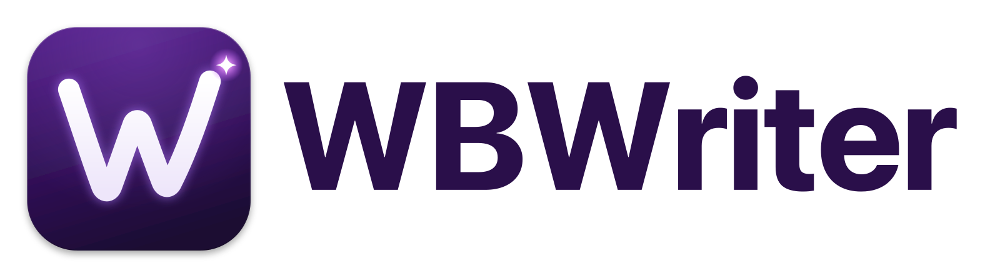
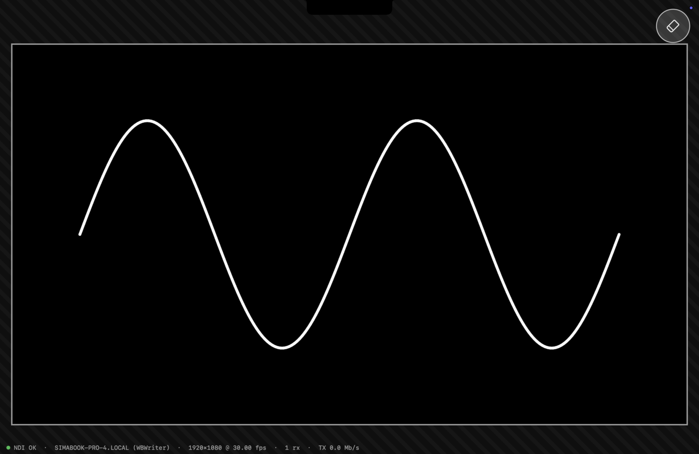
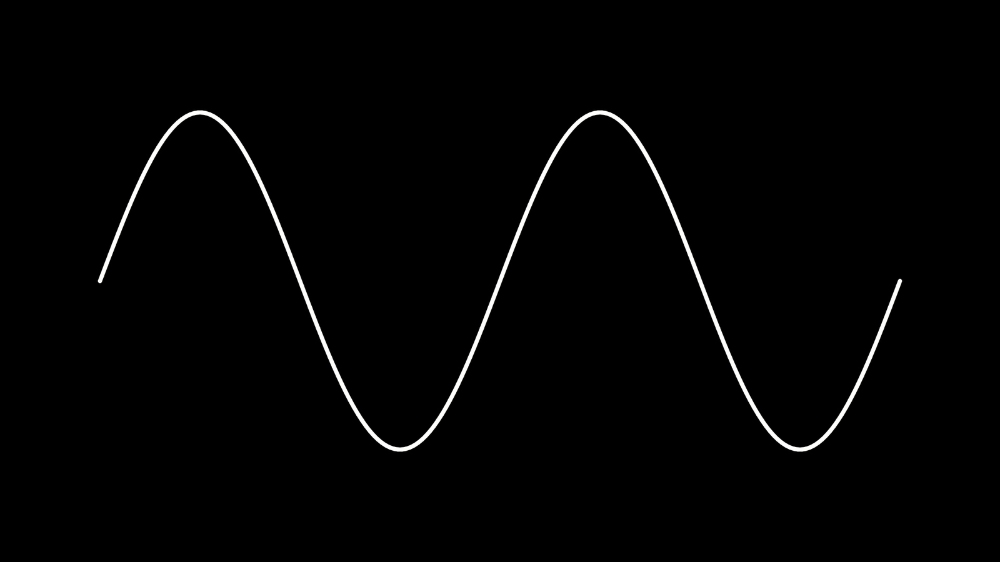
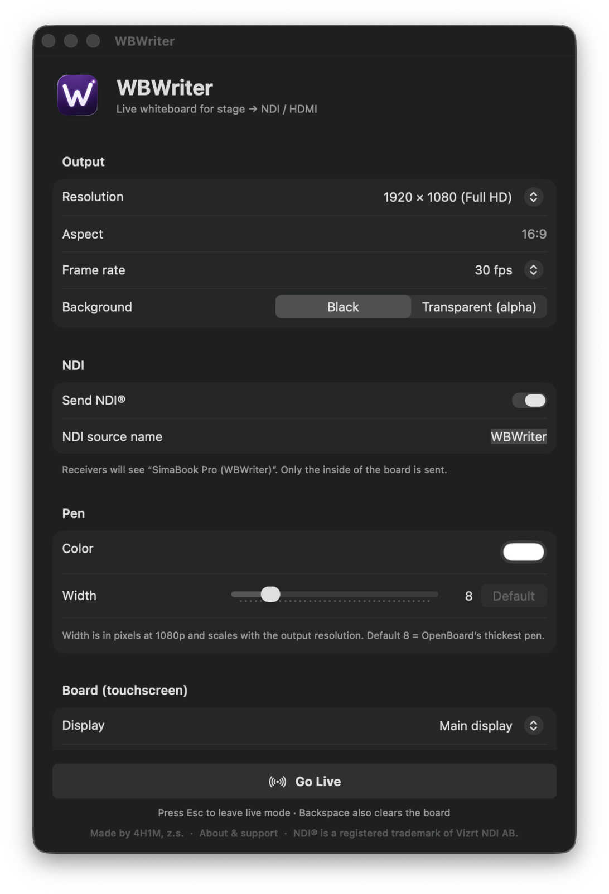
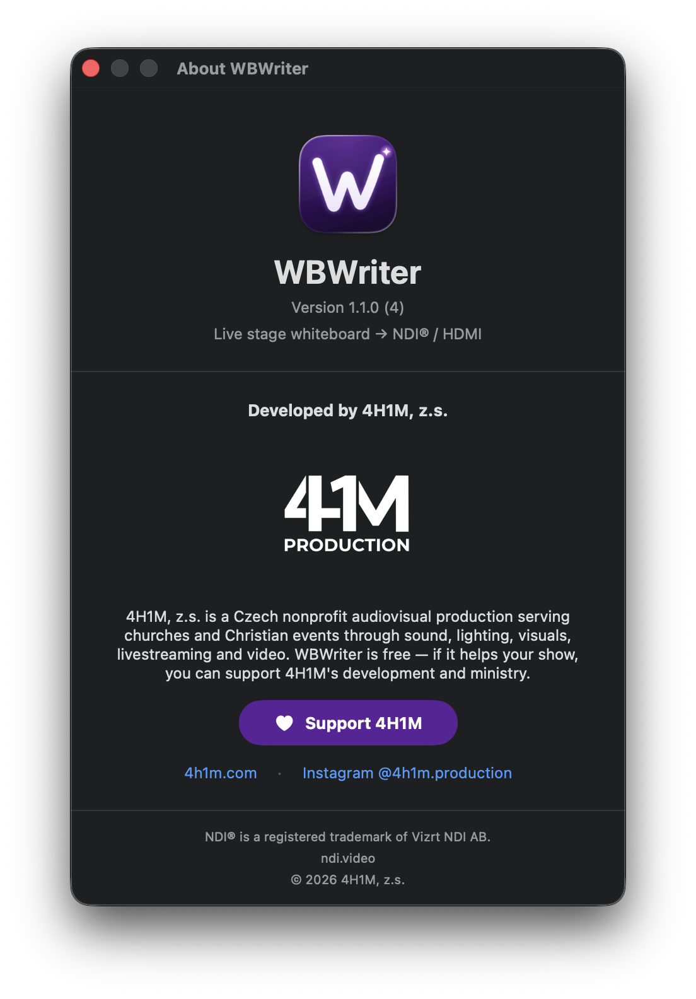

<p align="center">
  <picture>
    <source media="(prefers-color-scheme: dark)" srcset="Assets/logo-wordmark-dark.png">
    
  </picture>
</p>

<p align="center">
  <b>A live stage whiteboard.</b><br>
  Performers write on a touchscreen, and the audience sees the writing on the LED wall over <b>NDI®</b> or <b>HDMI</b>.
</p>

<p align="center">
  <a href="https://wbwriter.app/"></a>
  &nbsp;
  <a href="https://github.com/4H1Mzs/wbwriter/releases/latest"></a>
  &nbsp;
  <a href="https://www.darujme.cz/4h1m"></a>
</p>

<p align="center">
  <a href="https://github.com/4H1Mzs/wbwriter/releases/latest"></a>
  
  
  
  <a href="LICENSE"></a>
  
</p>

<p align="center"><sub>Made with ❤️ by <a href="https://4h1m.com/"><b>4H1M, z.s.</b></a>, a Czech nonprofit audiovisual production</sub></p>

---

<p align="center">
  
</p>

## What it does

WBWriter is a stripped-down, show-safe take on [OpenBoard](https://openboard.ch/en/download). You set everything up before the show. Live mode has no toolbars, palettes or menus. There's only the board.

- 🖊️ **One pen.** It's white by default, at OpenBoard's thickest default width. Color and width are set before the show and can't change during it.
- 📐 **Aspect-locked board.** You enter your LED wall's resolution. The board fills the touchscreen, scaled to fit with the aspect ratio kept exactly. The area outside it is hatched so it's obvious where you can't draw, and the board stays clear of the MacBook camera notch.
- 🧽 **One clear button.** It's large enough to hit with a finger but stays out of the way, in a corner you choose. It can be single tap, double tap (safer), or turned off completely.
- 📡 **Clean NDI® output.** The stream is the board content only, with no UI and no border, at the exact output resolution. The background is **black** (BGRX) or **transparent** (BGRA with straight alpha, for keying). The source name and frame rate are configurable, from 23.976 to 60 fps.
- 🖥️ **Optional HDMI program feed.** A full-screen clean feed can run on any external display.
- 📊 **Status line.** It sits outside the board in a bottom corner of the touchscreen. It goes below the board when there's room, or into the margin beside it and wraps onto several lines. It's never sent to the outputs. It shows NDI health, measured fps, receiver count, network TX, source name, resolution, and battery when running on battery.
- 📱 **Optional web control.** From a phone on the same network, clear the board or show the performer a message in the hatched area, until you remove it or for a set time. Messages never reach the outputs. A PIN can protect it.
- 🔄 **Built-in updates.** At launch, WBWriter offers new versions from GitHub with their changelog, and installs them only when they're signed by 4H1M. It never interrupts a live show.
- 🛡️ **Show-safe.** While live, the Dock and menu bar are hidden and sleep is turned off. **Esc** goes back to setup.

<p align="center">
  
  <br><sub><b>What NDI receivers get:</b> the board content only, at the exact output resolution.</sub>
</p>

<p align="center">
  
  &nbsp;
  
  <br><sub><b>Pre-show setup</b> and <b>About</b>.</sub>
</p>

## Download

| Platform | Status |
|---|---|
| **macOS 13+** (Apple Silicon and Intel) | ✅ **[Download the latest release](https://github.com/4H1Mzs/wbwriter/releases/latest)** (signed and notarized `.dmg`) |
| **Windows** | 🚧 Coming soon |
| **Linux** | 🚧 Coming soon |

Open the `.dmg` and drag **WBWriter** into **Applications**.

## Quick start

1. Open **WBWriter**. When macOS asks to let it find devices on your **local network**, click **Allow**. NDI can't work without this.
2. Set up the show:
   | Setting | Notes |
   |---|---|
   | Resolution | Your LED wall's pixel size. Presets or custom. |
   | Frame rate | Should match your video system. |
   | Background | *Black* for a normal feed, *Transparent* for an alpha overlay. |
   | NDI source name | Shows up on receivers as `MACHINE-NAME (your name)`. |
   | Pen color / width | Width 8 = OpenBoard's thickest default. It scales with resolution. |
   | Board display | Which screen is the touchscreen. |
   | Margin | Space around the board on the touchscreen. |
   | Clear gesture / button | Single tap, double tap, or none (no button), and which corner. |
   | Corner logo | A small, faint logo in the bottom-right corner of the touchscreen: 4H1M, your own image, or none. |
   | HDMI output | An external display for a clean feed, or *None*. |
   | Web control | Off by default. When on, it shows the address to open on a phone, with an optional port and PIN. |
3. Click **Go Live** (or press Return).
4. Write. To leave live mode, press **Esc**. **Backspace** also clears the board, for an operator at a keyboard.

Settings are saved between launches.

### Reading the status line

| Indicator | Meaning |
|---|---|
| 🟢 `NDI OK` | Sending at the target frame rate, with at least one receiver connected. |
| 🟡 `NDI waiting` | Sending fine, but no receiver is connected yet. |
| 🔴 `NDI DROPPING` | Sending below 90% of the target frame rate. |
| `TX … Mb/s` | Total outgoing traffic on the Mac's Ethernet and Wi-Fi interfaces. |
| `Battery …%` | Shown only when running on battery. It turns red at 20% or below. |

## Web control

Turn on **Web control** in the setup window, then open one of the addresses it shows (for example `http://Stage-Mac.local:8080`) on a phone or laptop on the same network. From that page you can:

- **Clear board.** Tap twice to confirm.
- **Message to the performer.** It appears in yellow in the hatched area on the touchscreen and stays until you tap **Remove message**, or disappears after 10 seconds, 30 seconds or a minute. It's never sent to NDI or HDMI.

The actions only work while WBWriter is live. If other people share the network, set a PIN. The page asks for it once and remembers it. If the macOS firewall is on, allow incoming connections for WBWriter when asked.

## Receiving the feed

Any NDI receiver works: vMix, OBS (DistroAV), Resolume, NDI Studio Monitor, TriCaster, disguise, and so on. The source is announced through Bonjour (`_ndi._tcp`). If it doesn't show up:

- Check **System Settings → Privacy & Security → Local Network**. WBWriter must be enabled.
- Check that the sender and the receiver are on the same subnet, and that multicast/mDNS isn't blocked.

## Building from source

Requirements:

- macOS 13+ with Xcode 15+ (Swift 5.10+)
- The [NDI SDK for Apple](https://ndi.video/for-developers/ndi-sdk/), installed at `/Library/NDI SDK for Apple`

```bash
swift run              # dev build, runs against the SDK's libndi
scripts/build.sh       # universal, Developer ID–signed app + .zip + .dmg
                       # (+ .pkg when a Developer ID Installer certificate is present)
```

To notarize, store a notarytool profile once and pass it to the build:

```bash
xcrun notarytool store-credentials WBWriter --apple-id "you@example.com" --team-id <TEAM_ID> \
  --keychain ~/Library/Keychains/login.keychain-db
NOTARY_PROFILE=WBWriter NOTARY_KEYCHAIN=~/Library/Keychains/login.keychain-db scripts/build.sh
```

Storing the profile in the login keychain keeps notarization working while the Mac is locked, which matters on a build server. Other variables: `VERSION`, `BUILD`, `NDI_SDK`, `SIGN_ID`, `INSTALLER_ID`.

`WBWriter --selftest` goes live right away and draws a test stroke. It's useful for checking NDI or HDMI routing without touching the screen.

### Releases

To publish a release, push a `v*` tag. The [Release workflow](.github/workflows/release.yml) then runs on 4H1M's self-hosted Mac, which builds, signs, notarizes and staples the app and publishes the GitHub release. It never runs for pull requests.

### Website

The [wbwriter.app](https://wbwriter.app/) website is in [`site/`](site/). It's a static page served from Cloudflare, with Markdown docs and `llms.txt`. The Markdown files in `site/public/docs/` are the source of the docs: `python3 site/tools/build-docs.py` turns them into the HTML pages and `llms-full.txt`. To deploy, run `cd site && npm install && npx cf deploy`.

### Architecture

```
Sources/
  CNDI/                       NDI SDK headers + module map (links libndi)
  WBWriter/
    main.swift                App delegate, menus, setup ↔ live switching
    Settings.swift            Persistent settings (UserDefaults)
    SetupView.swift           SwiftUI pre-show configuration window
    AboutView.swift           About / support window
    Canvas.swift              Output-resolution BGRA bitmap; smoothed round-cap strokes
    BoardViews.swift          Touch board, HDMI output view, clear button, borderless windows
    ProductionController.swift  Live-mode lifecycle, 60 Hz display refresh, status line
    StatusMonitor.swift       NDI / network / battery status sampling
    NDISender.swift           Clocked NDI send loop on its own thread
```

- The canvas is one CoreGraphics bitmap at the exact output resolution. The board view, the HDMI view and NDI all read from it, so what the performer sees is pixel-for-pixel what goes out.
- Strokes use quadratic midpoint smoothing with round caps and joins.
- NDI runs on a dedicated thread using the SDK's video clock, so frames arrive at a steady rate. Pixels are copied only when the canvas changes. Transparent mode converts premultiplied alpha to straight alpha with vImage.

## Roadmap

- Windows and Linux builds
- Undo last stroke (optional, gesture-based)
- Pressure sensitivity for pen tablets

## About 4H1M

<p align="center">
  <a href="https://4h1m.com/">
    <picture>
      <source media="(prefers-color-scheme: dark)" srcset="Assets/4h1m-logo-white.png">
      
    </picture>
  </a>
</p>

WBWriter is developed by **4H1M, z.s.**, a Czech nonprofit audiovisual production serving churches and Christian events through sound, lighting, visuals, livestreaming and video. We build tools like this for our own productions and share them for free.

If WBWriter helps your show, please consider supporting 4H1M's development and ministry:

<p align="center">
  <a href="https://www.darujme.cz/4h1m"></a>
</p>

<p align="center">
  <a href="https://4h1m.com/">4h1m.com</a> · <a href="https://www.instagram.com/4h1m.production/">Instagram @4h1m.production</a> · <a href="mailto:simon@4h1m.com">simon@4h1m.com</a>
</p>

## License

WBWriter is open source under the [MIT License](LICENSE). © 2026 4H1M, z.s.

The NDI® SDK headers in `Sources/CNDI/` come from Vizrt NDI AB under the NDI SDK license and aren't covered by the MIT License.

## Credits

- NDI® is a registered trademark of Vizrt NDI AB. WBWriter uses the NDI® SDK, and the bundled `libndi.dylib` is distributed under the NDI SDK license. See `Contents/Resources/libndi_licenses.txt` in the app bundle and [ndi.video](https://ndi.video).
- Inspired by [OpenBoard](https://openboard.ch).

© 2026 4H1M, z.s.
